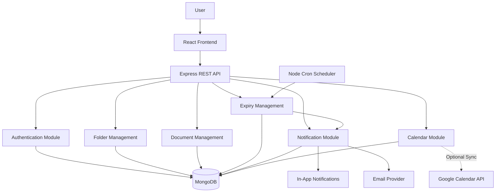
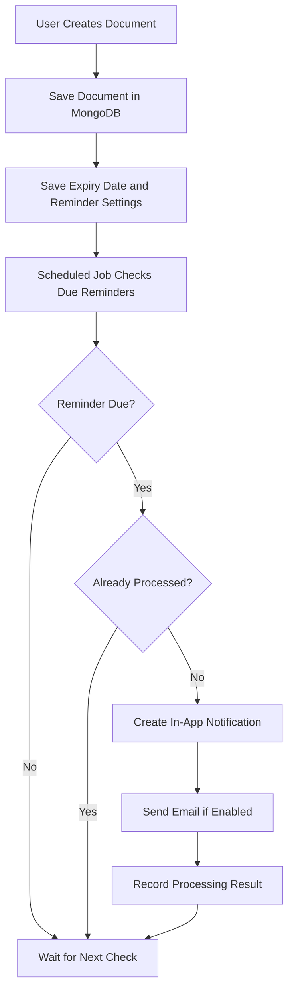
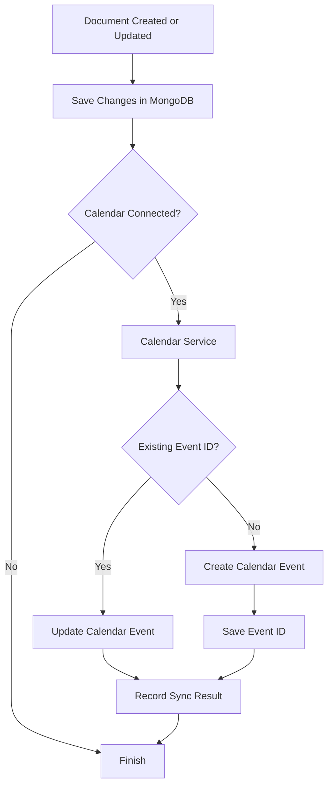
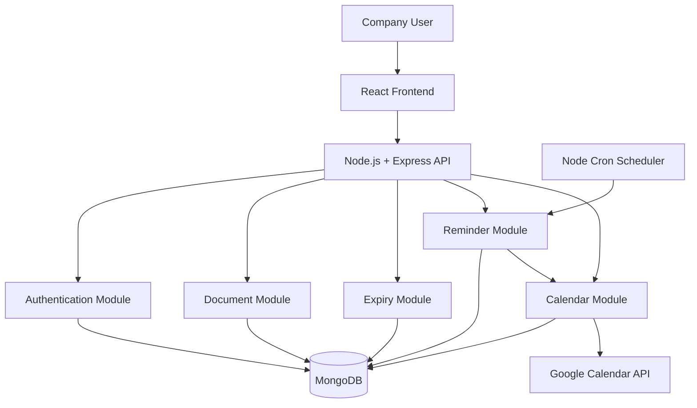
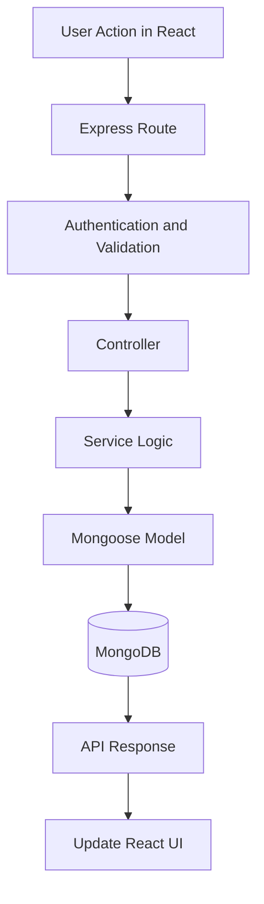
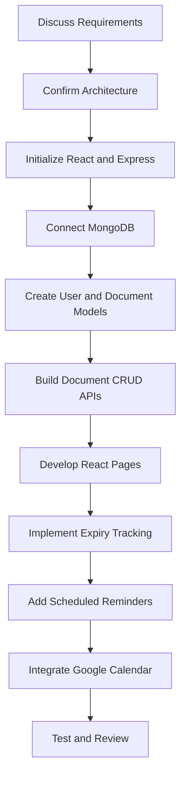

# DocumentVault — Technical Architecture

## 1. Project Objective

DocumentVault is a MERN application for managing company documents, tracking expiry dates, sending reminders, and synchronizing expiry events with a shared Google Calendar.

## 2. Technology Stack# DocumentVault

A MERN-based digital document locker for organizing personal and company documents, tracking expiry dates, and sending timely notifications.

## 1. Project Overview

DocumentVault allows users to store and organize documents in a hierarchical folder structure, manage expiry dates, and receive reminders before important documents expire.

The system follows a modular monolithic architecture using React, Node.js, Express.js, and MongoDB.

### Main Objectives

- Organize documents using folders and subfolders.
- Upload and manage document files securely.
- Track document expiry dates.
- Send notifications before and on expiry dates.
- Display unread notifications inside the application.
- Send email reminders.
- Optionally synchronize expiry events with Google Calendar.
- Protect documents through authentication and authorization.

## 2. Technology Stack

| Technology | Purpose |
|---|---|
| React | Frontend user interface |
| Node.js | Backend JavaScript runtime |
| Express.js | REST API development |
| MongoDB | Document metadata and application data |
| Mongoose | MongoDB schemas and queries |
| JWT | User authentication |
| bcrypt | Password hashing |
| Node Cron | Scheduled expiry checks |
| Google Calendar API | Optional calendar synchronization |
| Email provider | Email reminders |
| Multer | Handling file uploads |
| File storage provider | Secure document file storage |

The file-storage provider, email provider, and authentication strategy must be finalized before production deployment.

## 3. System Architecture



### Architecture Principles

- Use one Express backend application.
- Keep features organized into separate modules.
- Store document metadata in MongoDB.
- Store actual document files in secure file storage.
- Keep scheduled expiry checks separate from API request handling.
- Use Google Calendar as an optional integration.
- Enforce access permissions on the backend.

## 4. Main Features

### 4.1 User Authentication

- User registration and login.
- Secure password hashing.
- JWT-based authentication.
- Protected API routes.
- User-specific document access.
- Role-based permissions when required.

### 4.2 Folder and Subfolder Management

Users can organize documents using a tree structure.

Example:

```text
DocumentVault/
├── Personal Documents/
│   ├── Identity/
│   │   ├── Passport.pdf
│   │   └── IdentityCard.pdf
│   ├── Education/
│   │   ├── DegreeCertificate.pdf
│   │   └── MarkSheets.pdf
│   └── Financial/
│
└── Company Documents/
    ├── Licenses/
    ├── Contracts/
    └── Insurance/
```

Users can:

- Create folders and subfolders.
- Rename folders.
- Browse parent and child folders.
- Move documents between permitted folders.
- Delete folders when their contents have been handled safely.

A folder stores its parent folder ID to represent the hierarchy.

### 4.3 Document Management

Users can:

- Upload documents.
- View document details.
- Download authorized files.
- Update document metadata.
- Assign documents to folders.
- Set or update expiry dates.
- Search and filter documents.
- Delete documents according to permission rules.

Suggested document fields:

- Document name.
- File-storage reference.
- Folder ID.
- Owner or organization ID.
- Upload date.
- Expiry date.
- Reminder settings.
- Calendar event ID, if synchronized.

### 4.4 Expiry Date Management

The application identifies documents approaching expiry.

Suggested default reminder schedule:

| Time | Action |
|---|---|
| 30 days before expiry | Advance reminder |
| 7 days before expiry | Upcoming expiry reminder |
| 1 day before expiry | Urgent reminder |
| On expiry date | Expiry-day notification |
| After expiry | Overdue status |

Reminder intervals should be configurable.

### 4.5 Notification Management

DocumentVault provides a notification experience similar to the notification features of Google Calendar.

#### In-App Notifications

- Notification bell in the React interface.
- Unread notification count.
- Notification list.
- Mark notifications as read.
- Open the related document from a notification.

#### Email Notifications

- Send expiry reminders by email.
- Notify the appropriate document owner or authorized recipient.
- Record delivery attempts and status.
- Retry temporary delivery failures.

#### Browser Push Notifications

This can be added in a later phase using service workers and a push-notification provider.

Push notifications require browser permission and additional configuration. Delivery is not guaranteed.

### 4.6 Google Calendar Integration

Google Calendar integration is optional.

When enabled, the application can:

- Create calendar events for document expirations.
- Update events when expiry dates change.
- Delete or cancel corresponding events when appropriate.
- Store the Google Calendar event ID for future updates.
- Synchronize selected expiry dates with an authorized shared calendar.

The backend must securely handle Google credentials and permissions.

Google Calendar notifications depend on event settings and the user's calendar configuration. They are separate from DocumentVault's own notification system.

## 5. Backend Folder Structure

```text
backend/
├── config/
│   ├── db.js
│   ├── storage.js
│   └── env.js
│
├── middleware/
│   ├── auth.middleware.js
│   ├── error.middleware.js
│   └── upload.middleware.js
│
├── modules/
│   ├── auth/
│   │   ├── auth.routes.js
│   │   ├── auth.controller.js
│   │   ├── auth.service.js
│   │   └── user.model.js
│   │
│   ├── folders/
│   │   ├── folder.routes.js
│   │   ├── folder.controller.js
│   │   ├── folder.service.js
│   │   └── folder.model.js
│   │
│   ├── documents/
│   │   ├── document.routes.js
│   │   ├── document.controller.js
│   │   ├── document.service.js
│   │   └── document.model.js
│   │
│   ├── notifications/
│   │   ├── notification.routes.js
│   │   ├── notification.controller.js
│   │   ├── notification.service.js
│   │   └── notification.model.js
│   │
│   └── calendar/
│       ├── calendar.routes.js
│       ├── calendar.controller.js
│       └── calendar.service.js
│
├── jobs/
│   └── expiryReminder.job.js
│
├── utils/
│   ├── date.utils.js
│   └── email.utils.js
│
├── app.js
├── server.js
├── .env.example
├── .gitignore
└── package.json
```

## 6. Frontend Folder Structure

```text
frontend/
├── public/
├── src/
│   ├── components/
│   │   ├── Navbar.jsx
│   │   ├── FolderTree.jsx
│   │   ├── DocumentList.jsx
│   │   └── NotificationBell.jsx
│   │
│   ├── pages/
│   │   ├── Login.jsx
│   │   ├── Register.jsx
│   │   ├── Dashboard.jsx
│   │   ├── Documents.jsx
│   │   ├── ExpiringDocuments.jsx
│   │   └── Notifications.jsx
│   │
│   ├── services/
│   │   ├── api.js
│   │   ├── document.service.js
│   │   ├── folder.service.js
│   │   └── notification.service.js
│   │
│   ├── App.jsx
│   └── main.jsx
│
├── .env.example
└── package.json
```

## 7. Database Design

### 7.1 Users Collection

Purpose: Stores user account information.

Suggested fields:

- `_id`
- `name`
- `email`
- `passwordHash`
- `role`
- `createdAt`

Passwords must never be stored in plaintext.

### 7.2 Folders Collection

Purpose: Stores the folder hierarchy.

Suggested fields:

- `_id`
- `name`
- `parentFolderId`
- `ownerId`
- `organizationId`, if applicable
- `createdAt`
- `updatedAt`

The root folder has a `parentFolderId` of `null`.

Folder ownership and access rules must be validated when creating, moving, or deleting folders.

### 7.3 Documents Collection

Purpose: Stores document metadata.

Suggested fields:

- `_id`
- `name`
- `folderId`
- `ownerId`
- `organizationId`, if applicable
- `storageKey`
- `mimeType`
- `expiryDate`
- `reminderOffsets`
- `calendarEventId`
- `createdAt`
- `updatedAt`

The `storageKey` points to the actual file in the selected storage provider.

### 7.4 Notifications Collection

Purpose: Stores in-app notification records.

Suggested fields:

- `_id`
- `userId`
- `documentId`
- `type`
- `title`
- `message`
- `scheduledFor`
- `readAt`
- `status`
- `createdAt`

Possible notification types:

- `expiry_upcoming`
- `expiry_today`
- `document_expired`
- `calendar_sync_failed`

### 7.5 Reminder Processing

The application must track which reminders have been processed to avoid sending duplicate notifications.

A separate reminder collection or durable job records can store:

- `documentId`
- `userId`
- `reminderOffset`
- `scheduledFor`
- `status`
- `attemptCount`
- `lastAttemptAt`
- `sentAt`

Use a unique key or equivalent idempotency rule for each document, recipient, reminder type, and scheduled occurrence.

## 8. API Endpoints

All protected endpoints require valid authentication and appropriate permissions.

### Authentication

| Method | Endpoint | Purpose |
|---|---|---|
| POST | `/api/auth/register` | Register user |
| POST | `/api/auth/login` | Log in |
| GET | `/api/auth/me` | Get current user |

### Folders

| Method | Endpoint | Purpose |
|---|---|---|
| POST | `/api/folders` | Create folder |
| GET | `/api/folders` | List accessible folders |
| GET | `/api/folders/:id/children` | Get child folders |
| PATCH | `/api/folders/:id` | Rename or update folder |
| DELETE | `/api/folders/:id` | Delete folder after validating its contents |

### Documents

| Method | Endpoint | Purpose |
|---|---|---|
| POST | `/api/documents` | Upload a document |
| GET | `/api/documents` | List accessible documents |
| GET | `/api/documents/:id` | Get document details |
| PATCH | `/api/documents/:id` | Update document metadata |
| DELETE | `/api/documents/:id` | Delete document |
| GET | `/api/documents/:id/download` | Download authorized file |
| GET | `/api/documents/expiring` | List upcoming expirations |

### Notifications

| Method | Endpoint | Purpose |
|---|---|---|
| GET | `/api/notifications` | List user's notifications |
| GET | `/api/notifications/unread-count` | Get unread count |
| PATCH | `/api/notifications/:id/read` | Mark notification as read |
| PATCH | `/api/notifications/read-all` | Mark all as read |

### Calendar

| Method | Endpoint | Purpose |
|---|---|---|
| GET | `/api/calendar/status` | Get calendar connection status |
| POST | `/api/calendar/connect` | Start authorization flow, if OAuth is used |
| POST | `/api/calendar/sync/:documentId` | Request event synchronization |
| DELETE | `/api/calendar/events/:documentId` | Remove the linked event when authorized |

The exact calendar routes depend on whether the application uses OAuth or a service account. Calendar operations must not expose credentials to the frontend.

## 9. Expiry Notification Workflow



### Important Processing Rules

- Use a consistent timezone for scheduling.
- Use an appropriate date-only representation for expiry dates where the time is not meaningful.
- Do not create the same reminder twice.
- Track failed email deliveries separately from successful in-app notifications.
- Retry temporary errors safely.
- Handle documents whose expiry dates have changed.
- Do not rely only on the React frontend to trigger reminders.

## 10. Google Calendar Synchronization Workflow



Google Calendar synchronization should be retryable. If the database update succeeds but the calendar request fails, the system must record the failed sync and retry it without creating duplicate events.

## 11. Initial Setup

### Prerequisites

- Node.js LTS
- npm
- MongoDB local installation or MongoDB Atlas
- Git
- Google Cloud project, only if calendar integration is enabled
- File-storage and email-provider accounts, as required

### Initialize the Project

```bash
mkdir DocumentVault
cd DocumentVault

mkdir frontend backend
```

### Initialize the Backend

```bash
cd backend
npm init -y
npm install express mongoose dotenv cors bcrypt jsonwebtoken
npm install multer node-cron
npm install googleapis
npm install -D nodemon
```

`googleapis` can be added when calendar integration is ready. Choose and install the required email and file-storage SDKs after selecting providers.

### Initialize the Frontend

Open a separate terminal:

```bash
cd DocumentVault/frontend
npm create vite@latest . -- --template react
npm install
npm install axios react-router-dom
```

### Start the Applications

Configure the required environment variables and MongoDB connection first.

Example development commands, after adding the relevant scripts to `package.json`:

```bash
# Backend
npm run dev

# Frontend
npm run dev
```

Run each command in its respective project directory.

## 12. Environment Variables

Backend `.env.example`:

```env
PORT=5000
NODE_ENV=development

MONGODB_URI=

JWT_SECRET=

FRONTEND_URL=http://localhost:5173

FILE_STORAGE_PROVIDER=
FILE_STORAGE_BUCKET=

EMAIL_PROVIDER=
EMAIL_FROM=

GOOGLE_CALENDAR_ENABLED=false
GOOGLE_CALENDAR_ID=
GOOGLE_CLIENT_ID=
GOOGLE_CLIENT_SECRET=
GOOGLE_REDIRECT_URI=
```

These are configuration placeholders. The actual variables depend on the selected storage, email, and Google authentication approach.

For service-account authentication, use a securely managed service-account credential or workload identity instead of exposing credentials in frontend code. Do not commit secret values to Git.

## 13. Security Requirements

- Hash passwords using bcrypt or an appropriate password-hashing alternative.
- Validate all API inputs.
- Check document ownership and access permissions on every protected operation.
- Prevent users from accessing another user's files by changing document IDs.
- Restrict upload file types and sizes.
- Store files in private storage.
- Use short-lived or otherwise controlled download access.
- Keep authentication tokens and Google credentials secure.
- Use HTTPS in production.
- Apply rate limiting to authentication and sensitive endpoints.
- Record important security and synchronization errors.
- Back up the database and document files.
- Never trust a folder ID, document ID, owner ID, or role supplied by the client without server-side verification.

## 14. Testing Plan

### Authentication

- Register and log in successfully.
- Reject invalid credentials.
- Reject unauthenticated access to protected routes.

### Folder Management

- Create parent and child folders.
- Retrieve the correct tree.
- Prevent unauthorized folder access.
- Handle deletion of non-empty folders safely.
- Prevent invalid parent relationships and folder cycles.

### Document Management

- Upload valid files.
- Reject unsupported or oversized files.
- Update expiry dates.
- Verify document ownership and download permissions.

### Notifications

- Generate reminders when due.
- Avoid duplicate reminders.
- Mark notifications as read.
- Handle missed scheduled checks.
- Retry temporary email failures.
- Verify timezone and date-boundary behavior.

### Calendar Integration

- Create an event for an authorized calendar.
- Update an existing event.
- Prevent duplicate events after retries.
- Handle expired credentials and API errors.
- Verify that failed synchronization is recoverable.

## 15. Development Roadmap

### Phase 1 — Project Foundation

- Initialize React and Express.
- Configure MongoDB.
- Establish API error handling.
- Configure environment variables.

### Phase 2 — Authentication

- Implement registration and login.
- Add authentication middleware.
- Establish ownership and permission rules.

### Phase 3 — Folder and Document Management

- Implement the folder tree.
- Implement secure file uploads.
- Add document CRUD operations.
- Add document search and filtering.

### Phase 4 — Expiry Management

- Store expiry dates.
- Display upcoming and overdue documents.
- Add configurable reminder settings.

### Phase 5 — Notifications

- Implement the notification model and APIs.
- Build the notification bell and unread count.
- Add scheduled reminder processing.
- Integrate email notifications.

### Phase 6 — Google Calendar

- Configure Google Cloud credentials and permissions.
- Implement calendar event creation and updates.
- Store event IDs and synchronization status.
- Handle retries and failed synchronization.

### Phase 7 — Testing and Deployment

- Test authentication and permissions.
- Test file access and reminder processing.
- Verify calendar synchronization.
- Configure production environment variables.
- Deploy frontend, backend, database, and file storage.

## 16. Decisions Requiring Senior Approval

Before production implementation, confirm:

1. Is DocumentVault for personal users, company users, or both?
2. Which file-storage provider will be used?
3. What user roles and sharing permissions are required?
4. Will email notifications be enabled?
5. Are browser push notifications required?
6. Will Google Calendar be optional or mandatory?
7. Will one shared company calendar or individual calendars be used?
8. Which reminder intervals should users receive?
9. What is the retention and backup policy for deleted documents?
10. What deployment environment will be used?

## 17. Final Recommendation

Begin with a modular monolithic MERN application.

Implement features in this order:

1. Authentication and access control.
2. Folder and subfolder tree.
3. Secure document management.
4. Expiry tracking.
5. In-app notifications.
6. Email reminders.
7. Optional Google Calendar synchronization.
8. Browser push notifications if required.

Keep MongoDB as the source of truth for document metadata and expiry dates. Use private file storage for document contents, and make reminder processing reliable and idempotent.

This architecture is simple enough for an initial MERN implementation and can be extended as DocumentVault grows.


- Frontend: React
- Backend: Node.js + Express.js
- Database: MongoDB + Mongoose
- Authentication: JWT
- Calendar: Google Calendar API
- Scheduler: Node.js Cron
- File Storage: To be finalized with the senior developer

## 3. Selected Architecture

**Modular Monolithic Architecture**

The frontend and backend are separate applications. The backend runs as one application containing multiple feature modules.

Each module has a specific responsibility, making the system easy to understand, develop, and maintain.

## 4. System Architecture Diagram



## 5. Component Responsibilities

| Component | Responsibility |
|---|---|
| React Frontend | Display documents, forms, expiry dates, and reminders |
| Express API | Receive requests and connect frontend operations to backend logic |
| Authentication Module | Login, token verification, and user permissions |
| Document Module | Create, view, update, and delete document records |
| Expiry Module | Store expiry dates and identify expiring documents |
| Reminder Module | Determine when reminders should be processed |
| Calendar Module | Create and update Google Calendar events |
| MongoDB | Store users, document metadata, expiry dates, and event IDs |
| Node Cron | Run scheduled expiry checks |
| Google Calendar API | Synchronize expiry events with the shared calendar |

## 6. Backend Request Flow



## 7. Suggested Project Folder Structure

```text
DocumentVault/
├── frontend/
│   ├── src/
│   │   ├── components/
│   │   ├── pages/
│   │   ├── services/
│   │   └── App.jsx
│   └── package.json
│
├── backend/
│   ├── config/
│   │   └── db.js
│   ├── modules/
│   │   ├── auth/
│   │   │   ├── auth.routes.js
│   │   │   ├── auth.controller.js
│   │   │   └── auth.service.js
│   │   ├── documents/
│   │   │   ├── document.routes.js
│   │   │   ├── document.controller.js
│   │   │   ├── document.service.js
│   │   │   └── document.model.js
│   │   ├── reminders/
│   │   └── calendar/
│   ├── middleware/
│   ├── jobs/
│   │   └── expiryCheck.job.js
│   ├── app.js
│   ├── server.js
│   ├── .env.example
│   └── package.json
│
└── README.md
```

## 8. Initial Development Flow



## 9. Initial Database Collections

| Collection | Purpose |
|---|---|
| users | User accounts and roles |
| documents | Document details, owner, file reference, and expiry date |
| reminders | Reminder schedule and processing status |

Google Calendar event IDs can initially be stored in the related document or calendar-sync record. The final design depends on the synchronization requirements.

## 10. Security and Configuration

- Store credentials in environment variables.
- Never commit `.env` files to Git.
- Verify authentication and authorization on protected APIs.
- Validate incoming data before database operations.
- Restrict document access according to user permissions.
- Protect Google Calendar credentials and tokens on the backend.
- Use HTTPS in production.

## 11. Initial Development Phases

1. Requirements gathering and senior approval.
2. Frontend and backend initialization.
3. MongoDB connection and schema design.
4. Authentication and document CRUD.
5. Expiry tracking and reminder scheduling.
6. Google Calendar integration.
7. API, permission, and synchronization testing.

## 12. Pending Decisions

- Which file-storage solution should be used?
- Will all users share one Google Calendar?
- Which user roles and permissions are required?
- How many days before expiry should reminders be sent?
- Should reminders use email, in-app notifications, or both?
- How should failed calendar synchronization be retried?

## 13. Final Recommendation

Start with a modular monolithic MERN application. Keep authentication, documents, reminders, and calendar integration organized into separate modules within one backend.

Implement document CRUD first, then expiry tracking, reminders, and Google Calendar synchronization.

Review the pending decisions with the senior developer before implementing the advanced integrations.
