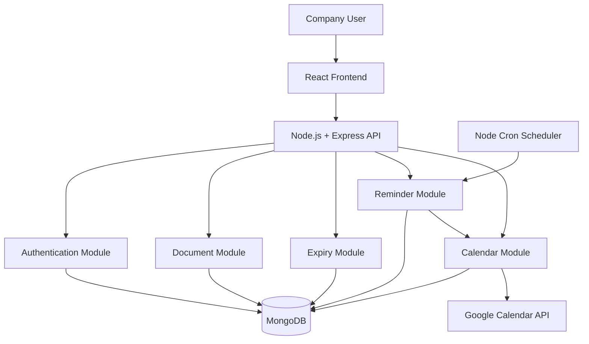
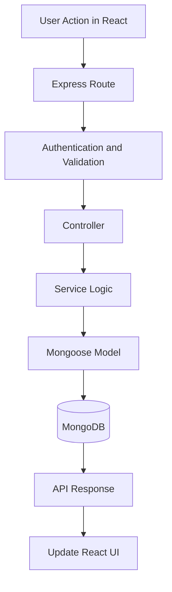
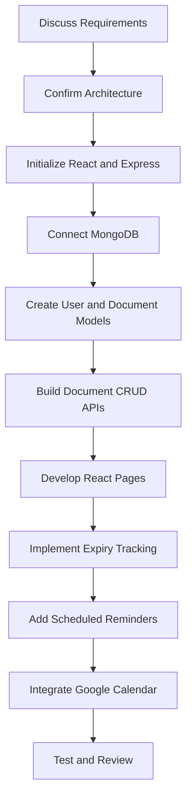

# DocumentVault — Technical Architecture

## 1. Project Objective

DocumentVault is a MERN application for managing company documents, tracking expiry dates, sending reminders, and synchronizing expiry events with a shared Google Calendar.

## 2. Technology Stack

- Frontend: React
- Backend: Node.js + Express.js
- Database: MongoDB + Mongoose
- Authentication: JWT
- Calendar: Google Calendar API
- Scheduler: Node.js Cron
- File Storage: To be finalized with the senior developer

## 3. Selected Architecture

**Modular Monolithic Architecture**

The frontend and backend are separate applications. The backend runs as one application containing multiple feature modules.

Each module has a specific responsibility, making the system easy to understand, develop, and maintain.

## 4. System Architecture Diagram



## 5. Component Responsibilities

| Component | Responsibility |
|---|---|
| React Frontend | Display documents, forms, expiry dates, and reminders |
| Express API | Receive requests and connect frontend operations to backend logic |
| Authentication Module | Login, token verification, and user permissions |
| Document Module | Create, view, update, and delete document records |
| Expiry Module | Store expiry dates and identify expiring documents |
| Reminder Module | Determine when reminders should be processed |
| Calendar Module | Create and update Google Calendar events |
| MongoDB | Store users, document metadata, expiry dates, and event IDs |
| Node Cron | Run scheduled expiry checks |
| Google Calendar API | Synchronize expiry events with the shared calendar |

## 6. Backend Request Flow



## 7. Suggested Project Folder Structure

```text
DocumentVault/
├── frontend/
│   ├── src/
│   │   ├── components/
│   │   ├── pages/
│   │   ├── services/
│   │   └── App.jsx
│   └── package.json
│
├── backend/
│   ├── config/
│   │   └── db.js
│   ├── modules/
│   │   ├── auth/
│   │   │   ├── auth.routes.js
│   │   │   ├── auth.controller.js
│   │   │   └── auth.service.js
│   │   ├── documents/
│   │   │   ├── document.routes.js
│   │   │   ├── document.controller.js
│   │   │   ├── document.service.js
│   │   │   └── document.model.js
│   │   ├── reminders/
│   │   └── calendar/
│   ├── middleware/
│   ├── jobs/
│   │   └── expiryCheck.job.js
│   ├── app.js
│   ├── server.js
│   ├── .env.example
│   └── package.json
│
└── README.md
```

## 8. Initial Development Flow



## 9. Initial Database Collections

| Collection | Purpose |
|---|---|
| users | User accounts and roles |
| documents | Document details, owner, file reference, and expiry date |
| reminders | Reminder schedule and processing status |

Google Calendar event IDs can initially be stored in the related document or calendar-sync record. The final design depends on the synchronization requirements.

## 10. Security and Configuration

- Store credentials in environment variables.
- Never commit `.env` files to Git.
- Verify authentication and authorization on protected APIs.
- Validate incoming data before database operations.
- Restrict document access according to user permissions.
- Protect Google Calendar credentials and tokens on the backend.
- Use HTTPS in production.

## 11. Initial Development Phases

1. Requirements gathering and senior approval.
2. Frontend and backend initialization.
3. MongoDB connection and schema design.
4. Authentication and document CRUD.
5. Expiry tracking and reminder scheduling.
6. Google Calendar integration.
7. API, permission, and synchronization testing.

## 12. Pending Decisions

- Which file-storage solution should be used?
- Will all users share one Google Calendar?
- Which user roles and permissions are required?
- How many days before expiry should reminders be sent?
- Should reminders use email, in-app notifications, or both?
- How should failed calendar synchronization be retried?

## 13. Final Recommendation

Start with a modular monolithic MERN application. Keep authentication, documents, reminders, and calendar integration organized into separate modules within one backend.

Implement document CRUD first, then expiry tracking, reminders, and Google Calendar synchronization.

Review the pending decisions with the senior developer before implementing the advanced integrations.
